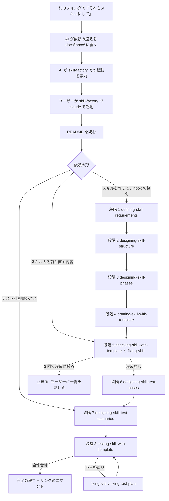

# スキル作成の利用の流れの設計(2026-10-25)

## 1. この文書について

この文書は、skill-factory のフォルダでユーザーがスキルを作る、直す、テストするときの利用の場面と、入口ごとの手順と、流れの図を決めた設計書です。ユーザーと AI は、規約「スキルを作る流れ」(仮の名前 skill-making-flow)と、skill-factory の README を、この文書の内容をもとに書く。

## 2. 前提

- skill-factory は、`.claude/rules`、`.claude/skills`、`.claude/hooks` にスキルの実体のフォルダを指すリンク(配られたフォルダでは写し)を持ち、`.claude/settings.json` に hook 3 本の登録を持つ。
- 8 段階とスキルの対応は、次の表のとおりである。出どころは、作った人の環境の設計書「スキル開発の流れの通し検証の計画(2026-10-24)」の章 3 である。

| 段階 | スキル | 入力 | 最終出力 |
|---|---|---|---|
| 1 | defining-skill-requirements | 依頼の文 | 要件定義書 |
| 2 | designing-skill-structure | 要件定義書 | 分割設計書 |
| 3 | designing-skill-phases | 分割設計書 | 構成の案 |
| 4 | drafting-skill-with-template | 構成の案 | SKILL.md とリファレンス |
| 5 | checking-skill-with-template と fixing-skill | スキルのフォルダ | 違反なしのスキル |
| 6 | designing-skill-test-cases | スキルのフォルダ | テスト計画書 |
| 7 | designing-skill-test-scenarios | テスト計画書、実施する範囲 | 章「シナリオテストの表」 |
| 8 | testing-skill-with-template | テスト計画書 | 判定の記録 |

## 3. 利用の場面

| 場面 | 入口 | 通る段階 | 出口 |
|---|---|---|---|
| 1. 新しいスキルを作る | skill-factory を開いて「<作業>をするスキルを作って」と言う。または、別のフォルダで「それもスキルにして」と言う | 1 から 8 | ユーザーが、作ったスキルを、使うプロジェクトの `.claude/skills/` か `$HOME/.claude/skills/` にリンクする |
| 2. 既存のスキルを直す | skill-factory を開いて、直したいスキルの名前と直す内容を言う | 5、8 | 直したスキルのテストが全件合格 |
| 3. 既存のスキルをテストする | skill-factory を開いて、テスト計画書のパスか、スキルの名前を言う | 6 から 8 | 判定の記録 |
| 4. 配られた skill-factory で初めて使う | 配られたフォルダで claude を起動し、README を読む | 場面 1 と同じ | 場面 1 と同じ |

4 つの場面は、ユーザーの機械に Claude Code と Node.js が入っていることを前提とする。

## 4. 入口 A: ユーザーが skill-factory を開いて始める流れ

1. ユーザーは、ターミナルで skill-factory のフォルダに `cd` を実行し、`claude` を起動する。
2. ユーザーは、README の案内に沿って、「<作業>をするスキルを作って」と言う。
3. AI は、規約「スキルを作る流れ」の規則「最初の依頼から段階を決める」で段階 1 と決める。AI は、段階の名前と、defining-skill-requirements が受け取る入力(依頼、要件定義書の出力先 `docs/`、既にあるスキルを探すフォルダ `.claude/skills/`)を返す。
4. AI は、段階 1 から 8 を、規約「スキルを作る流れ」の規則「ユーザーへの完了の報告のあとに次の段階を始める」に従って順に進める。ユーザーは、各段階の承認を出し、段階 4 の出力先と段階 7 の実施する範囲を答える。
5. AI は、段階 8 の判定の記録が全件合格なら、ユーザーへの完了の報告に、作ったスキルのパスと、使うプロジェクトへのリンクのコマンドを添える。

## 5. 入口 B: 別のフォルダで「それもスキルにして」と言う流れ

1. ユーザーは、別のプロジェクトのフォルダで AI と作業しながら、「それもスキルにして」と言う。
2. AI は、依頼の控えを `<skill-factory のパス>/docs/inbox/<日付>-<作業の名前>.md` に書く。控えを書く決まりは、グローバルに残す規約 skill-or-rule に足す規則とする。控えは、次の 5 つを持つ。
   - 依頼の文
   - 元のフォルダのパス
   - スキルにしたい作業の説明(AI がその場で行った手順)
   - 関係するファイルのパス
   - 期待する最終出力
3. AI は、ユーザーに「skill-factory で `claude` を起動し、`docs/inbox/<ファイル名>` のスキルを作って、と言ってください」と案内する。
4. ユーザーは、入口 A の手順 1 から始める。手順 2 の依頼は「`docs/inbox/<ファイル名>` のスキルを作って」になる。AI は、控えの 5 つの項目を読み、段階 1 への入力にする。
5. 以降は、入口 A の手順 4 と 5 と同じ。手順 5 のリンクのコマンドは、控えの「元のフォルダのパス」の `.claude/skills/` を指す。

## 6. フローチャート

## 7. この設計を動かすために直す箇所

| 箇所 | 今の状態 | 直し方 |
|---|---|---|
| defining-skill-requirements の「既にあるスキルを探すフォルダ」の既定の値 | 作業フォルダの `skills/`(SKILL.md の 18 行目) | AI が規則「最初の依頼から段階を決める」の「返す内容」で `.claude/skills/` を渡すか、ユーザーがスキルの既定の値を直す |
| 入口 B の「依頼の控え」の形と、控えを書く決まり | skill-or-rule にも、他の 7 本の規約にも書かれていない | ユーザーは、グローバルに残す規約に規則を 1 つ足す |
| skill-or-rule の置き場 | グローバルと skill-factory の両方に置くと、skill-factory では 2 回読み込まれる | ユーザーが、両方に置くか、片方にするかを決める |
