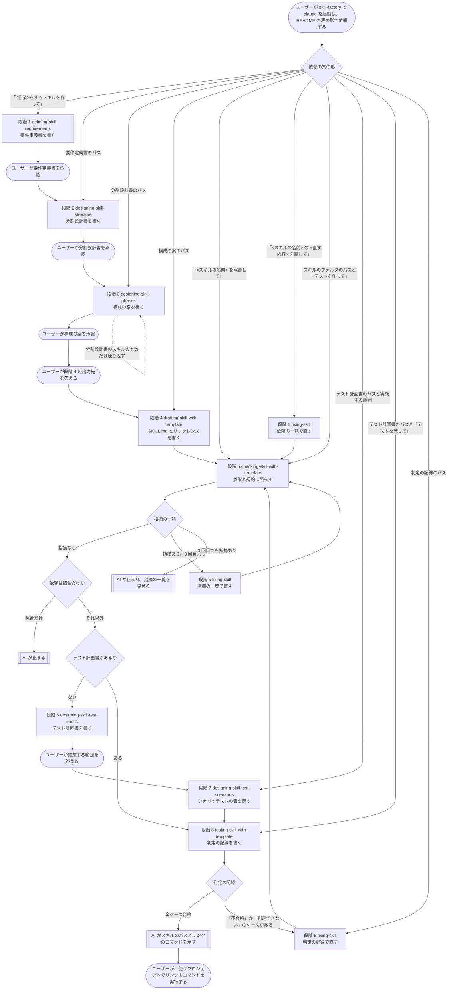

# 操作の流れ

この文書は、skill-factory でユーザーが claude を起動してから、作ったスキルを使うプロジェクトにリンクするまでの操作の流れを、1 つの図で持つ文書です。README の「使い方」の表が依頼の文の形と始める段階を持つのに対して、この文書は、段階の順と、ユーザーが承認か答えを出す点と、AI が止まる点を持ちます。依頼の文の形の全件は、規約 skill-making-flow の規則「最初の依頼から始める段階を決める」の表にあります。

## 図の読み方

- 角の丸い四角は、ユーザーの操作です。
- 四角は、AI が段階のスキルを流す作業です。段階の番号は、規約 skill-making-flow の規則「段階と、段階が使うスキルと、段階の入力と最終出力」の表の番号です。
- ひし形は、分岐です。
- 二重線の四角は、AI が止まり、ユーザーの次の操作を待つ点です。

## 図

## 確認と承認の画面で進めるとき

ユーザーは、ターミナルで claude を起動する代わりに、skill-factory で `node ui/server.mjs` を実行し、ブラウザで http://127.0.0.1:4173/ を開いて、同じ依頼の文を画面の入力欄から送れます。図の段階の順と止まる点は、画面で進めるときも同じです。AI は、段階のスキルが質問か承認を出す前と、段階の完了の報告のあとに、作業のフォルダの `ui/state.json` を書き、画面は、その state.json の文書と決めてもらうことを出します。依頼の形ごとの開き方は、`docs/スキル作成の確認と承認の画面/設計書.html` の章 2 にあります。

## 図にある成果物の置き場

作ったスキルと、要件定義書、分割設計書、構成の案、依頼の一覧は、`output/<スキルの名前>/` に置かれます。テスト計画書と判定の記録は、`output/<スキルの名前>/tests/` に置かれます。
